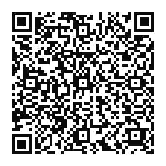

# Anthony Muniz

**AI & Backend Engineer.** I make LLM agents work with real customers, and I measure it.

Most AI agents look great in a demo and fall apart with real customers. I'm the engineer who finds out why and fixes it, with numbers to prove the fix worked.

I'm open to remote backend and AI engineering roles with US and European teams. I also take on small freelance projects through my company, Insight AI & Automation.

[anthonymuniz.dev](https://anthonymuniz.dev) | [LinkedIn](https://www.linkedin.com/in/anthony-mpo-dev) | [anthonympodev@gmail.com](mailto:anthonympodev@gmail.com)

## Work

- **AI support agent for a B2B SaaS** (2026). It answers customers on WhatsApp, web chat and email. I shipped about 30 releases in 4 weeks, and replies got 3x faster. Python, LLMs, RAG, n8n, HubSpot.
- **Credit analysis pipeline** (2024 to 2026). I rebuilt a credit fund's manual credit analysis as Python services with queues and workers. FastAPI, RabbitMQ, Celery, Redis.
- **LogStream** (side project). My first Go project. A sidecar agent streams logs over gRPC to a live dashboard, and healthmon blocks new requests to an external API once its error rate crosses a threshold. Go, gRPC, WebSocket, React.
- **RAG side projects** (2026). A PDF notes app and a resume generator on ChromaDB, plus Kai, my personal copilot, with embeddings and cosine similarity in NumPy. FastAPI, ChromaDB, Gemini embeddings, Celery.
- **Tuberculosis surveillance research** (2023 to 2025). My undergrad thesis, on a FAPEMAT research fellowship. Scrapers for Brazil's public health database feed a dashboard and a forecasting study. Python, Selenium, Pandas, Parquet.

## Freelance

Through Insight AI & Automation, I automate the manual work in small businesses. Most projects are one of two things: an n8n workflow that moves data between HubSpot, Google Sheets, Gmail and WhatsApp, or an AI chatbot that answers from your own docs and hands off to a human. Fixed scope, fixed price, async.

## Where's the code?

Most of my work lives in private repositories, client and company code under NDA, so my public graph looks quiet. The code of my site is public: [portfolio](https://github.com/Anthony-MPO-dev/portfolio).

## Support

If something here helped you, you can support it with a Pix (Brazil only).

Pix key: `07fea1e9-e489-4ccd-8b7f-828cc4eb4b32`

<picture>
  <source media="(prefers-color-scheme: dark)" srcset="https://github.com/Anthony-MPO-dev/Anthony-MPO-dev/blob/output/github-contribution-grid-snake-dark.svg" />
  <source media="(prefers-color-scheme: light)" srcset="https://github.com/Anthony-MPO-dev/Anthony-MPO-dev/blob/output/github-contribution-grid-snake.svg" />
  
</picture>
